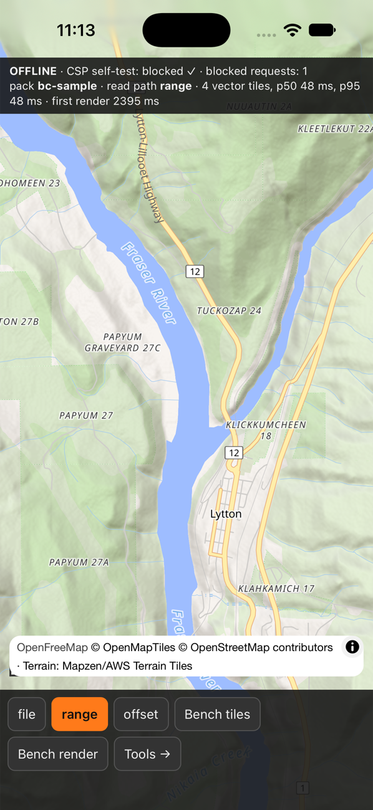
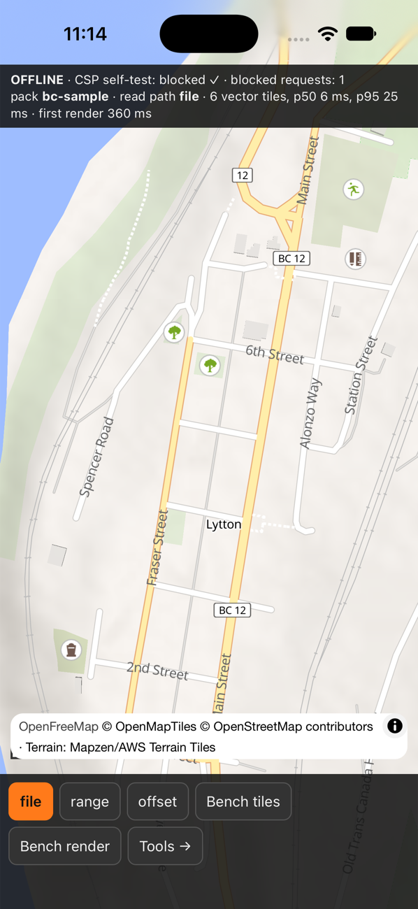
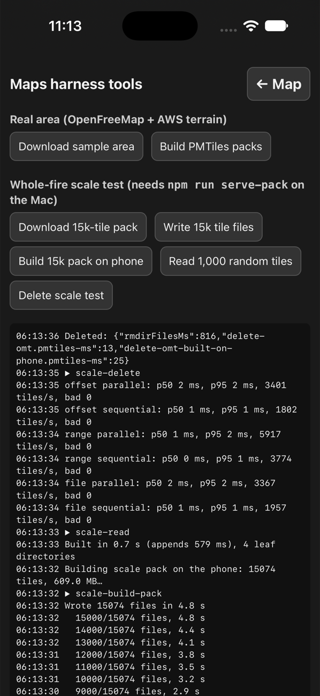

# Native storage spike: an offline basemap from Capacitor Filesystem (iOS)

Phase 0, item 1 of [the rebuild plan](avenza-rebuild-plan.md). Run on
2026-11-17 with the dev-only harness in [`native-harness/`](../native-harness/).

**Question.** Can MapLibre draw a basemap offline from tiles kept in Capacitor
Filesystem storage, inside an iOS app, fast enough for field use, at
whole-fire scale?

**Answer: yes.** MapLibre 5.24 drew the OpenFreeMap vector basemap with
hillshade, labels and icons from tiles, glyphs and sprites stored in Capacitor
Filesystem storage. It ran in the iOS simulator, on a page that can't reach
the network. Each tile read takes a fraction of a millisecond. MapLibre's own
work, not storage, decides how fast a view settles. At whole-fire scale (one
pack of 15,074 tiles, 0.6 GB), a random tile read still takes 0.3 ms.

**Recommendation.** Store each pack source as **one PMTiles v3 file** under
`Library/NoCloud/maps/_packs/<pack>/`. Read tiles by **byte range through
Capacitor's own scheme handler**: `Capacitor.convertFileSrc` + `fetch` with a
`Range` header. It was the fastest of the three paths. Its bytes reach the
page as binary (no base64), it needs no new plugin, and it keeps a whole fire
in one file that downloads, deletes and AirDrops as one unit.
`Filesystem.readFile({ offset, length })` on the same file is the fallback.
Don't use one file per tile for packs.

| Offline overview (range path) | Street level (file path) | Scale test log |
|---|---|---|
|  |  |  |

---

## 1. Setup

| | |
|---|---|
| Harness | `native-harness/`: its own `package.json` and lock. `@capacitor/core`, `@capacitor/ios` and `@capacitor/cli` 8.6.0, `@capacitor/filesystem` 8.1.5 (the crew app's exact versions). Swift Package Manager (`capacitor-swift-pm` 8.6.0, `ion-ios-filesystem` 2.0.1), no CocoaPods. `maplibre-gl` 5.24.0 (same as this repo), `pmtiles` 4.5.0 reader. Same `server` settings as the crew app (`capacitor://localhost`). |
| Device | iPhone 18 Pro simulator, iOS 27.2, Xcode 27.2, Apple-silicon Mac. |
| Real area | About 25 km² around a small BC town (bbox −121.62, 50.215 → −121.55, 50.26), z6–14. 36 OpenMapTiles vector tiles from OpenFreeMap (planet build `20261115_080022_pt`), 36 AWS Terrain Tiles (terrarium PNG), 18 glyph files (3 Noto Sans fonts × 6 ranges) and 4 sprite files. Downloaded in the app, 4 requests in flight, 5.3 s. That made 60 OpenFreeMap requests (2.7 MB), far inside its offline terms. 9.4 MB on disk, holding both layouts. |
| Storage | `Directory.LibraryNoCloud` → `Library/NoCloud/maps/_packs/bc-sample/`: `pack.json`, `style.json` (Liberty, rewritten to local URLs, plus a hillshade layer), `glyphs/`, `sprites/`, `tiles/<src>/<z>/<x>/<y>.<ext>` (one file per tile) and `omt.pmtiles` + `terrain.pmtiles` (packed). |
| Scale pack | 15,074 tiles: a z6–z14 pyramid over a 106 × 106 z14 block. Sizes are sampled from the real vector tiles and scaled to a 40 kB mean, so 609 MB. That's the top of the plan's range: 1M ha is ~5,700 vector + ~5,700 terrain tiles at z6–14, or ~15,000 vector tiles alone for ~2.7M ha. Payloads are random bytes: this tests storage and I/O, not drawing. |

### How "offline" was proven

- The map page's Content-Security-Policy allows no http(s) at all
  (`default-src`/`connect-src 'self' capacitor://localhost`, `worker-src blob:`,
  `img-src … data: blob:`). The page can only reach the app's own scheme. That
  scheme also serves files from the app container.
- On every launch the page deliberately fetches
  `https://tiles.openfreemap.org/planet`. The status bar shows the result
  ("CSP self-test: blocked ✓") and counts every CSP violation. In every run
  the only violation was that self-test.
- Before the screenshot runs, WebKit's caches (`Library/Caches`,
  `Library/WebKit`) were deleted, and the app was terminated and relaunched.
- Every tile, glyph and sprite reached MapLibre through the harness's custom
  protocols (`pkrange://`, `pkfile://`, `pkoffset://`, `pkasset://`). The
  overview launch read 4 vector and 12 terrain tiles (1.3 MB), plus 2 glyph
  and 2 sprite files, with 0 misses and 0 errors. No glyph range was missing.
- The Mac's own network stayed on. The simulator shares it, and other work
  on this Mac uses it, so the page's CSP is the network block.

## 2. The three read paths

| Path | How a tile reaches MapLibre | Bytes cross the bridge as |
|---|---|---|
| **file** | `Filesystem.readFile` on `tiles/<src>/<z>/<x>/<y>.<ext>` | base64 string, decoded in JS |
| **range** | PMTiles reader → `fetch(convertFileSrc(pack), { headers: { Range } })`, served by Capacitor's `WebViewAssetHandler` | binary `ArrayBuffer` (no plugin call) |
| **offset** | PMTiles reader → `Filesystem.readFile({ path: pack, offset, length })` (new in Filesystem 8.1) | base64 string, decoded in JS |

All three are registered as MapLibre custom protocols, so the same style can
point at any of them. A round-trip check read all 72 tiles through all three
paths and got identical bytes.

### Does Capacitor's iOS scheme handler support ranges?

**Yes.** Read in `@capacitor/ios` 8.6.0 `WebViewAssetHandler.swift` and
confirmed in the app. Details that matter for the storage layer:

- It handles any file extension. With a `Range` header it opens a
  `FileHandle`, seeks, reads only the requested bytes, and answers `206` with
  `Content-Range`. So a 0.6 GB pack is never loaded whole.
- It handles single `bytes=a-b` or `bytes=a-` ranges only. A suffix range
  (`bytes=-N`) is misread as `0-N`, multiple ranges aren't supported, and a
  range end past EOF isn't clamped: the header overstates, the data is right.
  The PMTiles reader only sends `a-b`.
- **A request without `Range` reads the whole file into memory**
  (`Data(contentsOf:)`). Never point a plain `fetch`, `` or `<a>` at a
  pack.
- It runs synchronously on the main (UI) thread. That's fine for tile-sized
  reads (~0.3 ms each here); avoid multi-megabyte reads through it.
- Responses carry `Cache-Control: no-cache`. The PMTiles reader keeps its own
  directory cache.

`Filesystem.readFile` with `offset`/`length` also seeks and reads only those
bytes (`ion-ios-filesystem` 2.0.1, `readPartialFile`), so the fallback path
scales too.

## 3. Results

Simulator numbers use the Mac's CPU and SSD, so they are best-case. Expect
real iPhones to be slower in absolute terms, the base64 paths most of all; the
ratios between paths should hold. WebKit's `performance.now()` has 1 ms
resolution, so per-tile figures are means over many reads, and throughput
comes from wall-clock time.

### 3.1 Reading tiles (no drawing)

Every tile in the real pack, in random order. Mean of 3 rounds, rotating
which path goes first.

| | file | range | offset |
|---|---|---|---|
| Vector tile (avg 22 kB), one at a time | 0.57 ms · 1,900 tiles/s | **0.34 ms · 3,000 tiles/s** | 0.62 ms · 1,700 tiles/s |
| Vector, 6 in flight | 3,400 tiles/s | **6,000 tiles/s** | 3,900 tiles/s |
| Terrain tile (avg 85 kB), one at a time | 0.75 ms · 116 MB/s | **0.30 ms · 288 MB/s** | 0.76 ms · 112 MB/s |
| Terrain, 6 in flight | 184 MB/s | **509 MB/s** | 189 MB/s |

The range path is about 2–2.5× faster. The gap grows with tile size, which is
the base64 cost.

### 3.2 Drawing the map

The same 9-view camera script ran on each path, twice, timing each view to
MapLibre's `idle` event.

| | file | range | offset |
|---|---|---|---|
| Per view, default 300 ms fades | ~600 ms (300–800) | ~600 ms (300–670) | ~600 ms (300–650) |
| Per view, fades off: median / max | 50 / 97 ms | **50 / 75 ms** | 50 / 183 ms |
| 9 views, fades off | 481–532 ms | **467–482 ms** | 483–617 ms |
| Tile request inside MapLibre, mean (vector / terrain) | 4.4 / 6.1 ms | **2.5 / 4.8 ms** | 10.2 / 9.0 ms |
| First render on a cold launch (map created → idle) | 359–380 ms | 350–367 ms | 346–353 ms |

With fades on, every path takes the same ~600 ms: that's MapLibre's fade
animation. With fades off, views settle in 16–100 ms on every path (one
183 ms outlier on offset). Storage is not what users will feel. Range has the tightest tail. Request times inside
MapLibre are longer than in 3.1 because they queue behind MapLibre's own
main-thread work.

**Cold WebKit caches.** The first launch after an install, or after WebKit's
caches are cleared, took **2.3–3.3 s** to the first drawn map (WebKit and GPU
caches warming up). Later launches took ~0.35 s. Plan a loading state for the
first open after each app update.

### 3.3 Whole-fire scale (15,074 tiles, 609 MB)

Two full runs; ranges show both.

| | One file per tile | One PMTiles file |
|---|---|---|
| Get it onto the phone | `writeFile` × 15,074, 4 in flight: **4.8–5.1 s** (1.3 ms per write) | `Filesystem.downloadFile` from a localhost server: **0.45–0.49 s**, streamed to disk natively. Network speed is the real limit. |
| Build it on the phone | — | Streaming writer + `appendFile` in 4 MB chunks: **0.66–0.67 s** |
| Random read, one at a time (1,000–2,000 tiles) | 0.51–0.68 ms · 1,460–1,960 tiles/s | **range 0.27–0.39 ms · 2,590–3,770 tiles/s**; offset 0.54–0.56 ms · 1,800–1,850 tiles/s |
| Random read, 6 in flight | 3,370–3,440 tiles/s | **range 5,920–6,270 tiles/s**; offset 3,400 tiles/s |
| Open the pack (header + root directory) | — | 1–8 ms. The 4 leaf directories (87 kB) load on demand and stay cached. |
| Files on disk | 15,074 files + 230 folders | 1 file |
| Space on disk | 640.0 MB for 609.0 MB of tiles: **+5.1%** | 609.1 MB: **+0.01%** (directories) |
| Delete it | `rmdir` recursive: **0.82–0.92 s** | `deleteFile`: **1–25 ms** |

Lookups through PMTiles leaf directories cost nothing measurable. Reads
didn't slow down between 72 and 15,074 tiles.

**Space overhead depends on tile size.** Files take whole 4 kB APFS blocks.
At the synthetic 40 kB mean that adds 5%. The real vector tiles here added
9.6% (864 KiB on disk for 789 KiB). A real fire pack is mostly z14 tiles,
which averaged **5.6 kB** here, so one file per tile would add roughly a third.

### 3.4 What a real fire pack weighs

These estimates scale the measured per-zoom tile sizes to a 100 × 100 km
(1M ha) box at 50.5° N. They come from 20 z14 tiles around one small town,
so treat them as an order of magnitude; built-up areas run larger.

| Source | Tiles | Size |
|---|---|---|
| Vector, z6–14 | 5,727 | 44 MB raw, ~28 MB gzipped (vector tiles gzip to 64%) |
| Terrain, z6–14 | 5,727 | 515 MB (z14 terrarium tiles averaged 109 kB; PNG doesn't compress further) |
| Terrain, z6–13 | 1,502 | 56 MB |
| Terrain, z6–12 | 413 | 21 MB |

**Terrain is what makes packs big.** Capping terrain at z12 (MapLibre
overzooms hillshade) brings a 1M ha basemap to **~50–65 MB in ~6,100 tiles**.
That's far below the plan's 0.2–0.6 GB estimate, which now looks like the
worst case. The 0.6 GB scale test covers it either way.

## 4. Findings that change the plan

1. **`Filesystem.downloadFile` ignores `LIBRARY_NO_CLOUD` on iOS.** Filesystem
   8.1.5's legacy download only knows `DOCUMENTS`, `CACHE` and `LIBRARY`.
   Anything else silently lands in `Documents`, which iCloud backs up and
   which isn't where we read from. The first scale download went there.
   **Workaround, verified:** `directory: Directory.Library`, path
   `NoCloud/maps/_packs/…`, which is the same folder as
   `Directory.LibraryNoCloud`. Also: `downloadFile` is deprecated in favour of
   `@capacitor/file-transfer`, can't resume, and stops if iOS suspends the app.
2. **OpenFreeMap caps in-app downloads.** Its terms allow at most 3,000 tiles
   or 50 MB per download, 4 requests in flight, and a User-Agent naming the
   app. A 1M ha vector pack is ~5,700 tiles, so whole-fire packs must be
   **hosted by us** (Phase 0.4), cut with `pmtiles extract` from OpenFreeMap's
   weekly planet PMTiles. The alternative is OpenFreeMap's permission
   (info@openfreemap.org). Small "save this area" downloads can still come
   tile-by-tile from OpenFreeMap and be packed on the phone; the harness's
   streaming writer built 0.6 GB in under a second in the simulator.
3. **Base64 is the hidden cost of the bridge.** iOS 18.2+ WebKit has native
   `Uint8Array.fromBase64` (used here). The crew app supports iOS 15+, where
   the `atob` fallback is much slower. The range path has no base64 at all.
4. **Gzipped tiles are handled.** Hosted planet extracts store vector tiles
   gzipped. `pmtiles` 4.x decompresses with `DecompressionStream` where
   WebKit has it (iOS 16.4+), and otherwise with its bundled `fflate`
   (iOS 15–16.3). That adds CPU per tile, which this spike didn't measure
   (its packs are uncompressed). Check it on a real phone.
5. **Pack size, not tile count, is the risk.** Cap terrain at z12–13 and
   gzip vector tiles. Then a whole fire is tens of MB, which keeps
   downloads, storage and AirDrop practical.
6. **A one-file pack can be shared.** A `.pmtiles` file goes through the
   Share plugin (AirDrop/Quick Share) to another crew phone offline. A
   15,000-file folder can't.

## 5. Recommendation for the Phase 0 storage layer

### Layout

```
Directory.LibraryNoCloud  (iOS: Library/NoCloud — no iCloud backup, not in the Files app, never purged)
  maps/
    _packs/                         shared basemap packs (not personal)
      <packId>/
        pack.json                   manifest: id, name, fire number, bbox + perimeter, zooms,
                                    sources, bytes, sha256 per file, created, attribution,
                                    format version
        basemap.pmtiles             OpenMapTiles vector, z6–14, gzip
        terrain.pmtiles             terrarium PNG, z6–12
    <ownerId>/                      personal (per the §0 contract): imported maps as their own
                                    .pmtiles pyramids, photos, exports
```

Style, glyphs and sprites ship in the maps build (Phase 0.2): 1.6 MB for
3 fonts × 6 ranges, plus 228 kB of sprites. One copy serves every pack. Store
them in `maps/_packs/_assets/` only if they must update separately from the
app.

### Pack format

PMTiles v3, clustered, one file per source. Vector tiles gzipped; terrain as
terrarium PNG; imported raster maps (Phase A1) as WebP or PNG pyramids in
their own `.pmtiles`. Keep each file under 2 GB: Capacitor's Android server
handles sizes as `int`. A 1M ha pack is ~50–65 MB, so there's ample room.

### Read path

One MapLibre protocol, e.g. `pmtiles://<packId>/<source>/{z}/{x}/{y}`, backed
by a `PMTiles` reader per file:

- **Store app:** a `Source` whose `getBytes(offset, length)` calls
  `fetch(convertFileSrc(uri), { headers: { Range: 'bytes=a-b' } })`.
  The harness's `RangeFetchSource` (`native-harness/src/pack.ts`) is about
  20 lines. Fallback `Source`: `Filesystem.readFile({ path, directory, offset, length })`
  (`FsOffsetSource`, same file). Use it if a platform's scheme handler
  ever ignores `Range`: check for `206`, as the harness does.
- **Website:** the same reader over OPFS. `pmtiles`' built-in `FileSource`
  reads a `File` with `slice(a, b)`, and an OPFS handle's `getFile()`
  returns one. Website packs stay best-effort, per §0.

### Writing packs

- **Hosted region packs (Phase 0.4):** download to `<file>.part`, check the
  size and sha256 against `pack.json`, then rename. Two ways:
  - **No new plugin:** download in Range chunks (e.g. 8 MB) with `fetch`
    and `Filesystem.appendFile`, resuming from the `.part` file's size after
    a drop. Field LTE drops are normal, so resume matters. Appending 609 MB
    took 0.6 s in the simulator. Needs CORS on our pack host.
  - **Legacy `Filesystem.downloadFile`:** streams natively, but no resume, no
    background, and the `NoCloud` workaround above is required.
- **Small areas from OpenFreeMap (≤ 3,000 tiles):** fetch tiles 4 at a time,
  then write one PMTiles with the streaming writer
  (`native-harness/src/pmtiles-write.ts`). It plans the directory from the
  tile sizes, then appends tile bytes in 4 MB chunks.
- Don't store one file per tile.

## 6. Specs for the Carmanah App master (crew app `mobile/`)

Nothing here needs a crew-app change before the maps PR. For that PR:

1. **Plugins:** none new for reading packs. `@capacitor/filesystem` must stay
   at **≥ 8.1.0** (the fallback path uses `offset`/`length`); 8.1.5 today ✓.
2. **Info.plist:** no new entries for offline basemaps or https pack
   downloads. The harness's `NSAllowsLocalNetworking` is only for its
   localhost test server; don't copy it. No privacy answers change: packs
   are map data, not personal data.
3. **`/capacitor.js` in `maps/index.html`:** already in the contract, and
   required: `convertFileSrc` and Filesystem come from `window.Capacitor`.
4. **CSP:** the crew app sets none today (Helmet's CSP is off, and the app
   has none). If one is ever added to the maps page, it must allow
   `connect-src capacitor://localhost` (iOS) and `https://localhost`
   (Android), `worker-src blob:` and `img-src blob: data:`.
5. **Account deletion** (`_removePersonFromPhone`): recursive
   `Filesystem.rmdir` of `maps/<ownerId>` in `Directory.LibraryNoCloud`, and
   drop IndexedDB `carmanah-maps.<ownerId>`. Packs in `maps/_packs/` are
   shared and stay. Run it asynchronously: big folders take about a second
   per 15,000 files.
6. **Background downloads (decision for later):** if crews need a pack
   download to continue with the app in the background, that means adding
   `@capacitor/file-transfer` (2.0.6, Capacitor ≥ 8) behind its own review.
   Phase 0 doesn't need it.
7. **Optional:** `@capacitor/device` (8.0.3) `getInfo().realDiskFree`, to
   warn before a large download. Filesystem can't report free space.
   Without it, handle the write failure.
8. **Android:** `allowBackup="false"` is already set, so packs aren't backed
   up. `LibraryNoCloud` maps to the app's files folder. See the follow-ups
   below.

## 7. Limits of this spike and follow-ups

- **Android not run** (no Android SDK on this Mac). From reading
  `@capacitor/android` 8.6.0 `WebViewLocalServer.java`: a `Range` request gets
  `206` with `Content-Range`, but the stream it returns is the whole file
  from byte 0. Capacitor relies on the WebView to skip to the start of the
  range. The stream is a `FileInputStream`, whose `skip()` seeks, so that
  should be cheap, but **it's unverified: test on an emulator** with the
  harness's `scale-read`. Sizes are `int` (2 GB cap). If ranges misbehave,
  switch to the offset fallback; it's one line.
- **Real iPhone not run.** It needs signing on Nick's device. Worth one pass:
  older phones, and iOS 15–18.1 where base64 has no native support.
- **The scale pack wasn't drawn.** Its payloads are random. Lookups through
  its leaf directories were measured. Drawing cost doesn't depend on pack
  size, and the real pack was drawn on all three paths.
- **Attribution:** production must credit OpenFreeMap, OpenMapTiles and
  OpenStreetMap, plus the AWS Terrain Tiles source list.

## Reproduce

See [`native-harness/README.md`](../native-harness/README.md). The raw result
JSON lands in `native-harness/.scratch/results/` (gitignored). Screenshots:
[`docs/native-storage-spike/`](native-storage-spike/).
