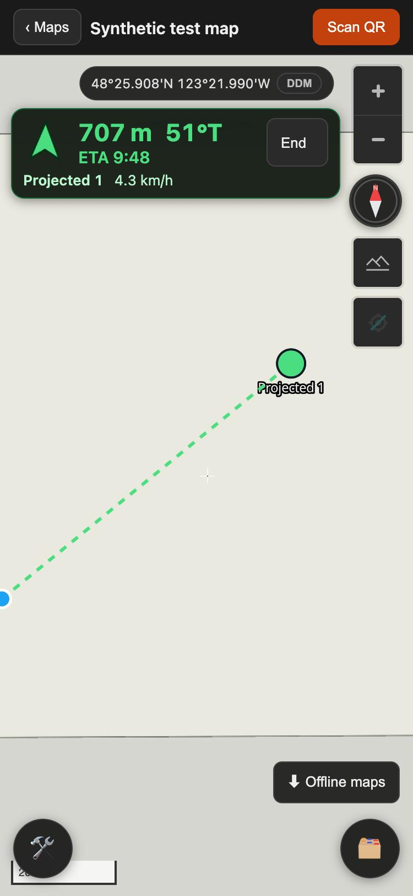
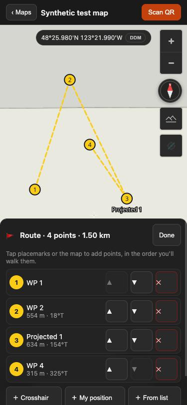
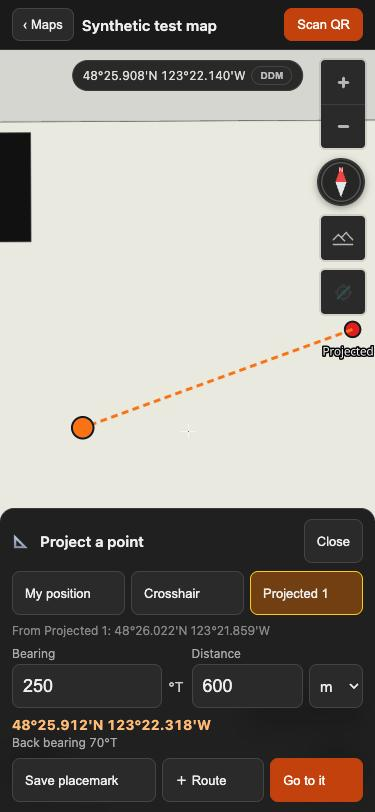
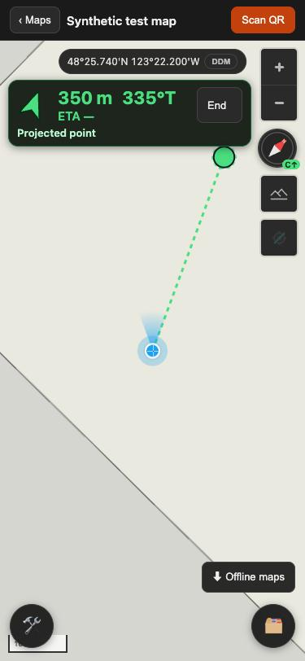

# Navigation and orientation

The Avenza "Location tools" wave: the compass and course-up, go to a point,
routes, project a point by bearing and distance, and arrival alerts. It all
works offline, in the embedded crew-app build, and on the base map or a
single custom map opened from My Maps. Screenshots use a synthetic test map.

| Go to | Plan a route | Project a point | Course-up |
|---|---|---|---|
|  |  |  |  |

## For crews

**Compass button** (top right, under zoom). The needle always points to
north. Tap it to switch between north-up and course-up; a turned or tilted
map is straightened first. In course-up (green ring, "C↑") the map turns so
the way you face is up, and the location dot comes on. The way you face is
the phone's compass; without one (a laptop, or no motion access on an
iPhone) it's your direction of travel from the GPS while you walk. Above
18 km/h (a truck, a helicopter) the GPS course wins, because the vehicle's
metal throws the compass off. Twisting the map with two fingers is off in
course-up. A blue cone on the location dot shows the heading, wider when
the compass is unsure.

**Navigate** (Tools → Navigate, or a feature's sheet):

- *Go to the crosshair.* For coordinates, use Find by coordinates first
  (any format), then Go to the crosshair.
- *Go to a placemark or feature*, nearest first. *Follow* a saved line
  (yours, an Avenza line, a track) point by point.
- *Plan a route.* Tap placemarks or the map, or add the crosshair, your
  position or a placemark from the list. Reorder with ▲ ▼, remove with ✕,
  reverse, save as a line to share. Start follows it leg by leg.
- *Project a point.* From you, the crosshair or a placemark: a bearing
  (degrees or mils, true or magnetic per Settings; "N45E" works) and a
  distance. The line shows on the map; save it as a placemark, go to it, or
  add it to the route. The back bearing is shown for the walk back.

The readout stays at the top of the map: distance, bearing, ETA at your
current speed, the target, route progress and, when the GPS is weaker than
the arrival radius, its accuracy. The arrow points to the target from the
way you face. Back, Skip and ✎ Route change a route while you're on it.
Navigation carries on if the app is closed and reopened.

**Alerts** (Settings → Navigation): an approach heads-up (default 100 m)
and arrival (default 20 m), each once per point. On arrival a route goes on
to the next point (or waits for Skip, if you turn that off). Each alert is a
message, a vibration (Android), a beep, and a notification when the page is
in the background. iPhones don't let a web page vibrate and the silent
switch mutes the beep. "Screen on" keeps the screen awake while
navigating (more battery).

## How it's built

| Piece | Where |
|---|---|
| Navigation maths: legs, ETA, route advance, alerts once each, lines as routes, saved sessions | `src/lib/navigation.ts` (pure; `test/navigation.test.ts`) |
| Bearing + distance → point, typed bearings and lengths | `src/lib/cogo.ts` (from the draw-edit branch; `destination()` is now the WGS84 geodesic, and this version wins when that branch merges) |
| Heading maths: DeviceOrientation → screen heading (tilt-compensated), iOS, magnetic → true, smoothing, compass vs GPS course | `src/lib/heading.ts` (pure; `test/heading.test.ts`) |
| Live heading: one shared sensor + GPS listener, iOS permission | `src/lib/compass.ts` |
| Compass button, course-up camera, heading cone | `src/map/compass-control.ts` (replaces MapLibre's compass in `MapView.tsx`) |
| Route / projection drawing | `src/map/nav-layers.ts` (own source, added on top) |
| Settings | `src/lib/nav-settings.ts`, `src/components/NavigationSettings.tsx` |
| Alerts, keep screen on | `src/lib/nav-alerts.ts` |
| UI and state | `src/hooks/useNavTools.tsx` (like `useGpsTools`: App lists its Tools entry and renders its view), `NavPanel`, `NavSheet`, `RoutePanel`, `ProjectSheet`, `FeaturePicker`, `navigation.css` |

Notes:

- Phones measure heading from magnetic north (iOS `webkitCompassHeading` is
  `CLHeading.magneticHeading`; Android's absolute orientation is the
  rotation-vector sensor). It's turned to true with the offline WMM2025
  declination at your fix (or the map centre) before the map uses it.
- WGS84 geodesics everywhere (`geodesic.ts` via `measure.ts`, `geo.ts` and
  `cogo.ts`): a point projected 250 m at 045° reads 250 m at 045° when you
  navigate to it, and GIS measures the same.
- Per person (shared phones): the session being navigated
  (`carmanah-maps.<ownerId>.nav-session`), the planned route (`…nav-route-draft`)
  and the settings (`…navigation`). `deleteOwnerData` removes them with the
  other prefs.
- Dev testing without a phone: `window.__posFeed(lng, lat, {speed, heading})`
  for GPS and `window.__headingFeed(magneticDeg, accuracy)` for the compass.

## Not yet

- Checked on real phones: the iOS motion prompt in Safari and in the crew
  app's WKWebView, landscape headings, and compass calibration in the field.
- Alerts with the screen locked or the app in the background (Phase D:
  background location, haptics, local notifications).
- Navigating *along* a line by its nearest point (cross-track distance);
  following a line goes point by point instead.
